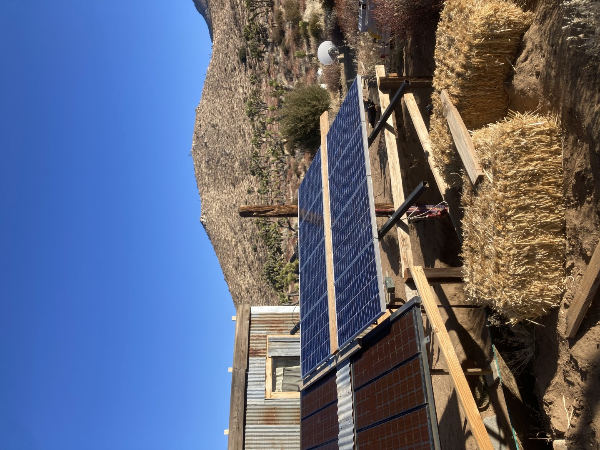
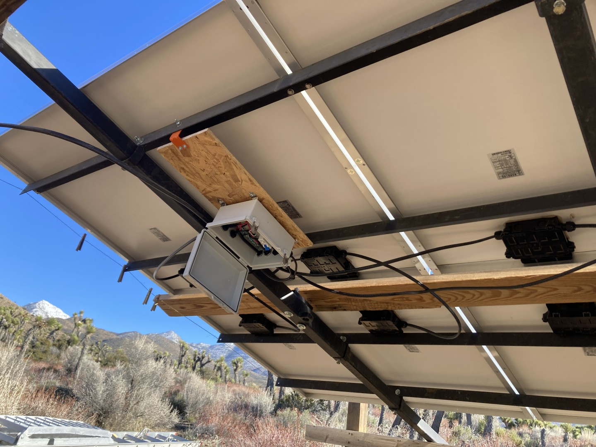
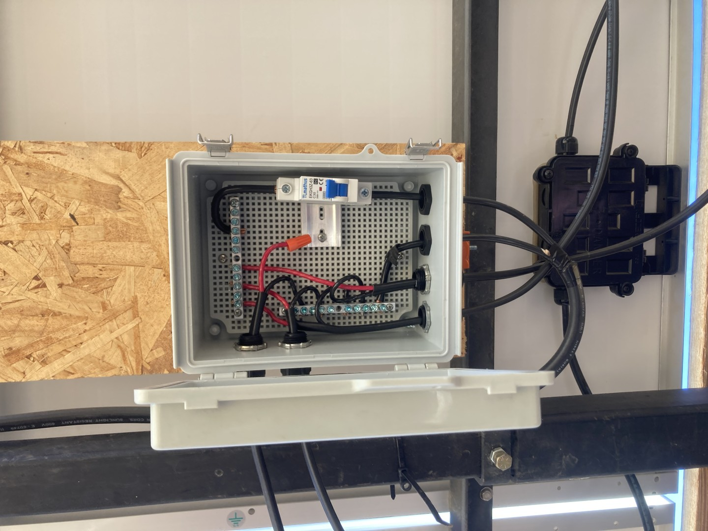
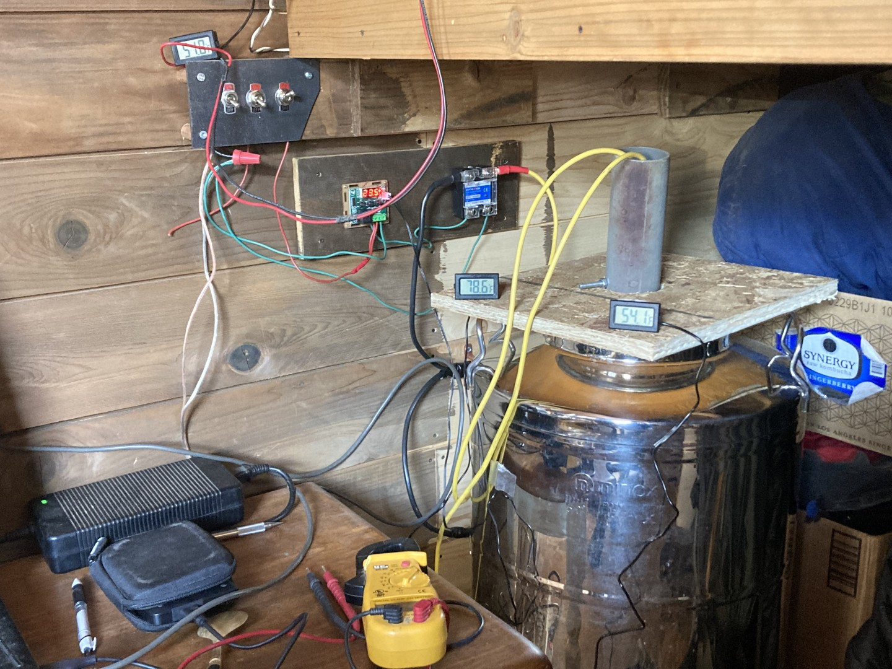
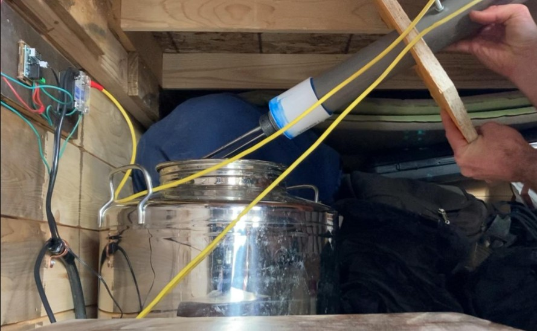

# Design notes

System Diagram:

Salvaged PV Array, (6) 120w panels

Combiner box

Combiner box closeup

The tank while monitoring temperatures

The heating element assembly

## Goals

Use salvaged solar panels and an electric heating element to heat a 14g tank of water in a tiny house for thermal comfort.

## Calculations

The array was (6) 12v 120w panels for a nominal 720w, but they were 20 years old so potential derating of up to 580w. 

The heating element is rated to 900w at 24v, which is 37.5amps and 0.64ohms. 

(I need to return to this build and find my notes to explain the first array configuration and then the second, with the panel specs, but point is I originally had it configured at too low of a voltage so it only put out about 120w. After reconfiguration it put out 450watts). 

## What didn't work

- The relay never worked. A dud?

- Using an OSB cap on top of a hot water tank is obviously dumb. It grew mold. I improved that by using a bolt to 'clip' the heating element to the lip of the tank, and affixing a flap of EPDM rubber to minimize evaporation and moisture transport to the space while ensuring no possibility of pressure buildup.

## Ideas for next version

- 

### References

  
